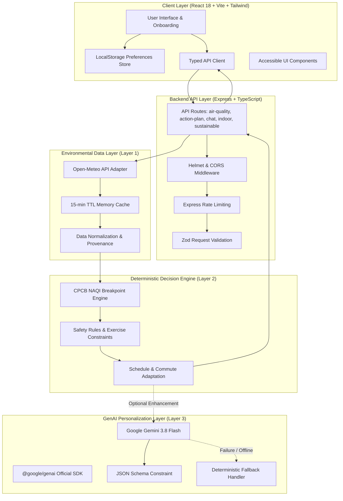

# AIRWISE — Architecture Documentation

AIRWISE is an air-quality decision-support application using CPCB breakpoint calculations and publicly documented health guidance, with model-derived environmental estimates. This document describes its technical architecture, data flow, safety invariants, and design patterns.

---

## 1. System Architecture Overview

AIRWISE is architected as a **4-Layer Hybrid AI System** designed to combine deterministic public health and safety rules with contextual GenAI personalization.



---

## 2. Layer-by-Layer Architectural Details

### Layer 1: Environmental Data Ingestion & Caching
- **Primary Source:** Open-Meteo Air Quality API (`https://air-quality-api.open-meteo.com/v1/air-quality`).
- **Underlying Atmospheric Model:** Copernicus Atmosphere Monitoring Service (CAMS) Global Atmospheric Composition model managed by ECMWF at ~0.4° resolution (~45 km).
- **Parameters Ingested:** Hourly $\text{PM}_{2.5}$, $\text{PM}_{10}$, $\text{NO}_2$, $\text{SO}_2$, $\text{CO}$, $\text{O}_3$, European AQI, and US AQI.
- **Cache Strategy:** In-memory TTL cache keyed by coordinates (`${lat.toFixed(2)},${lon.toFixed(2)}`). Default TTL is 15 minutes to respect provider quotas while ensuring prompt updates.
- **Provenance Integrity:** Every data response is stamped with observation time, retrieval timestamp, data type (`model_estimate`), and explicit attribution (`Open-Meteo.com & Copernicus CAMS`).

### Layer 2: Deterministic Decision Engine (Safety Core)
- **CPCB NAQI Implementation:** Rather than trusting third-party international conversions, AIRWISE calculates authentic Indian AQI directly using the linear interpolation formula:
  $$I = I_{\text{LO}} + \left(\frac{I_{\text{HI}} - I_{\text{LO}}}{B_{\text{HI}} - B_{\text{LO}}}\right) \times (C - B_{\text{LO}})$$
- **Maximum Operator Rule:** Final AQI = $\max(I_{\text{PM2.5}}, I_{\text{PM10}}, I_{\text{NO2}}, I_{\text{SO2}}, I_{\text{CO}}, I_{\text{O3}}, \dots)$.
- **Prerequisite Validation:** Follows CPCB mandate requiring at least 3 monitored criteria pollutants, with at least one being $\text{PM}_{2.5}$ or $\text{PM}_{10}$.
- **Safety Invariants:**
  1. High-intensity outdoor exercise is strictly prohibited in Poor, Very Poor, and Severe categories.
  2. Commuters on open transport (two-wheelers, auto-rickshaws, cycles, walking) are guided toward well-fitted particulate respirators when travel is unavoidable.
  3. Personal exposure reduction strictly supersedes carbon emissions reduction during acute smog episodes.

### Layer 3: GenAI Personalization & Resilience (Gemini 3.8 Flash)
- **SDK:** Official `@google/genai` (unified Gen AI SDK for Node.js).
- **Model:** `gemini-3.8-flash` by default (configurable via `GEMINI_MODEL`, with `gemini-3.5-flash-lite` supported as a cost-effective alternative) for high throughput, sub-second latency, and low carbon footprint.
- **Schema Enforcement:** Strict structured JSON output using `responseMimeType: 'application/json'` and `responseSchema` (Zod/Type declarations).
- **Prompt Injection Defense:** User inputs and environmental strings are treated as untrusted data. System instructions are isolated at the API boundary. The model is explicitly prevented from overriding safety invariants.
- **Deterministic Fallback:** If `GEMINI_API_KEY` is not configured, rate limits are hit (429), or network timeouts occur, AIRWISE serves the verified deterministic action plan and conversational fallback seamlessly without degrading user experience.

### Layer 4: Client Presentation & State Management
- **Single Page Application:** React 18 with client-side routing via React Router 7.
- **Styling & Tokens:** Tailwind CSS with custom CPCB AQI color ramps, accessible contrast ratios, and responsive breakpoints.
- **Accessibility:** Meets WCAG 2.2 AA. Color is never the sole indicator of danger (badges combine color, numerical bracket, and distinct SVG icons). Skip links and keyboard focus states are implemented.
- **State & Storage:** User schedule, commute habits, and voluntary sensitivity flags are persisted exclusively in browser `localStorage`. No user PII or precise GPS coordinates are transmitted to remote tracking servers.

### Security, Rate Limiting & Proxy Architecture
- **Air Quality Rate Limiting:** 60 requests/minute per client IP on `GET /api/air-quality` via `apiLimiter`.
- **AI Quota Protection:** 20 requests/minute per client IP shared across AI endpoints (`POST /api/action-plan`, `/api/chat`, `/api/indoor`, `/api/sustainable`) via `aiLimiter` to guard Gemini quota.
- **Deployment-Aware Proxy Configuration:** Express `trust proxy` is dynamically configured based on runtime environment:
  - *Local Development / Self-Hosted:* `trust proxy = false`. Rejects forwarded headers and calculates client IP directly from the TCP socket to prevent spoofing.
  - *Vercel Serverless Deployment:* `trust proxy = 1`. Trusts exactly 1 upstream proxy hop from the Vercel edge reverse proxy, ensuring accurate client IP resolution and preventing shared rate-limit bucket collisions. Blanket `trust proxy = true` is strictly prohibited.
- **Serverless & Store Limitations:**
  - *Store Mechanism:* In-memory store (`MemoryStore`) requiring no external paid infrastructure or remote caches (e.g. Redis, Upstash).
  - *Instance-Bound Enforcement:* Rate limits are enforced per running server process / lambda container, not as a globally synchronized distributed quota.
  - *Multi-Instance & Reset Behavior:* Ephemeral serverless lifecycles (cold starts, container recycling, and horizontal scaling across concurrent Vercel instances) can reset or fragment hit counters. The advertised values represent per-instance burst protections rather than globally guaranteed limits.

---

## 3. Data Contracts & Directory Structure

```
AQI AGENT/
├── package.json              # Monorepo workspaces root
├── .env.example              # Documented environment variables
├── README.md                 # Product overview & quick start
├── ARCHITECTURE.md           # System design & data flow
├── DATA_SOURCES.md           # Data integrity & provider comparisons
├── LIMITATIONS.md            # Technical and meteorological constraints
├── TESTING.md                # Verification commands & test matrix
├── BUILD_IN_PUBLIC.md        # Submission narratives for PromptWars
├── client/                   # React 18 Frontend
│   ├── src/
│   │   ├── components/       # Reusable UI & domain components
│   │   ├── pages/            # 8 Feature and navigation views
│   │   ├── services/api.ts   # Typed API client
│   │   ├── store/            # Preferences context
│   │   └── types/            # Data contracts
└── server/                   # Express Backend
    ├── src/
    │   ├── ai/client.ts      # Gemini client & prompts (gemini-3.8-flash)
    │   ├── engine/           # CPCB AQI & recommendation engine
    │   ├── providers/        # Open-Meteo adapter & cache
    │   ├── routes/           # REST endpoints
    │   ├── schemas/          # Zod validation schemas
    │   └── types/            # TypeScript interfaces
    └── tests/                # Vitest unit & integration suites
```
